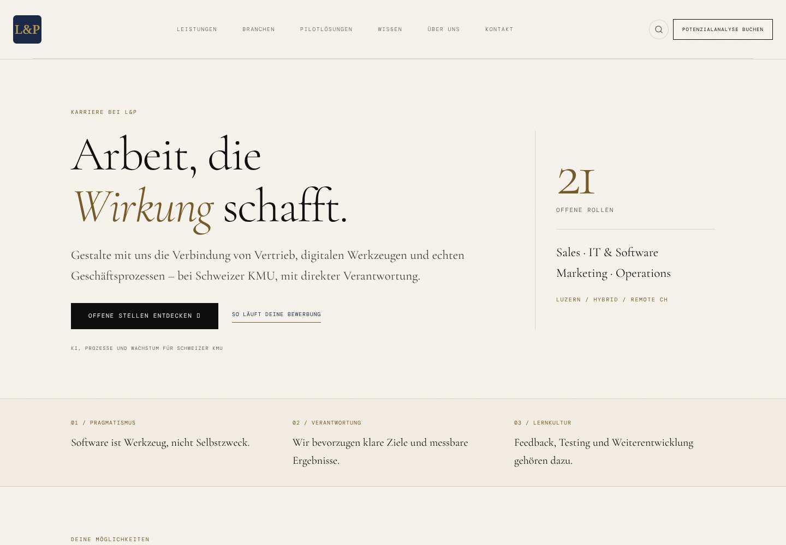
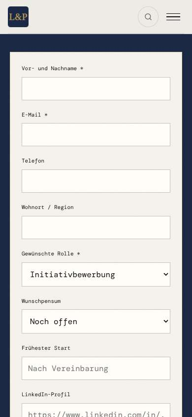
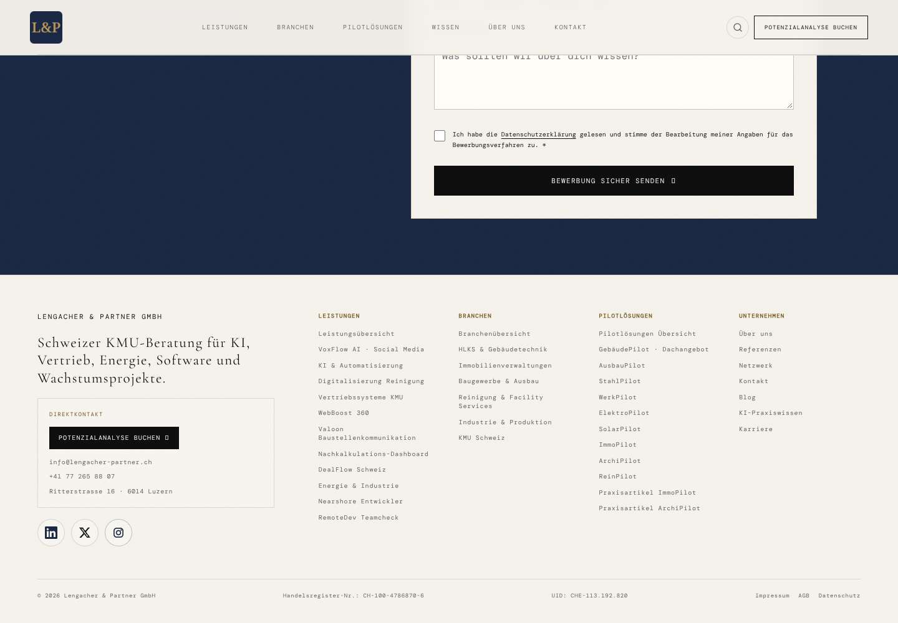

# L&P Karriere – ASU R04: Branding und Funktionsabgleich

**Stand:** 27.10.2026, nach Veröffentlichung und Live-Nachprüfung  
**Live:** https://jobs.lengacher-partner.ch/karriere  
**Code-Release:** `9b1e2da60ebdafdca9ddcf3a57f6ab90b1f1f858`  
**Deployment:** `dpl_D1AoMZUVmuGJLXy1Lhe6qLaXN1J3` – READY / production  
**Änderung:** [PR 2](https://github.com/moritzlengacher-oss/SDR-Recruiting/pull/2)

## Ergebnis

Die Übersicht und alle 21 Stellenseiten verwenden wieder das Original-Logo, die Original-Schriften, die originale L&P-Farbpalette sowie den vollständigen Header und Footer der Unternehmenswebsite. Die nachvollziehbaren Lücken beim Funktionsvergleich wurden behoben. Die öffentliche Domain liefert sämtliche 22 Seiten und die geprüften Dateien identisch zum getesteten Build aus.

## Ursache

Die ausgelagerte Karriereplattform hatte eine eigene grüne Gestaltung, ein nachgebautes Logo, eine Inter-Schriftdefinition und vereinfachte Navigations-/Footer-Komponenten. Die bisherigen 13 Tests bestanden trotzdem: Sie prüften den Stellenbestand, technische Metadaten und den Bewerbungs-Relay, aber keinen Abgleich mit dem Original-Branding.

## Zwei QA vor der Änderung

| Prüfung | Befund |
|---|---|
| QA 1 – Original-Branding | Originalwebsite und bisherige Karriereplattform verglichen. Im Browser: Original-H1 Cormorant Garamond und echtes Logo; bisherige Karriere-H1 Inter und kein Logo-Bild. Abweichungen bei Palette, Navigation und Footer bestätigt. |
| QA 2 – Funktionen | Bestehende Quelltexte und frühere Karriere-/Booking-Berichte abgeglichen. 21 Stellen und Bewerbungs-Relay vorhanden; Standort-/Level-Filter, Reset und Quick-Apply-Einstieg fehlten. Arbeitgeber-Inhalte und Zugang zum Karrieregespräch wieder ergänzt. 13/13 bestehende Tests als Ausgangszustand bestanden. |

## Umgesetzt

- Originales L&P-Logo und Favicons aus der aktuellen Unternehmenswebsite.
- **Cormorant Garamond** und **DM Mono**, sechs lokal ausgelieferte Original-Schriftdateien.
- Originalfarben: Paper `#f5f2ec`, Ink `#0d0d0d`, Gold `#b8975a`, Navy `#1a2744`; zugehörige Original-Abstufungen bleiben erhalten.
- Vollständiger Original-Header mit Megamenüs, mobiler Navigation, Suche und Unternehmenslinks.
- Vollständiger Original-Footer mit Kontakt, Themen-/Unternehmenslinks, Social-Icons und rechtlichen Angaben.
- Original-Markenbotschaft „KI, Prozesse und Wachstum für Schweizer KMU“ sowie die originale Unternehmensbeschreibung im Footer.
- Gemeinsame Komponenten auf allen 22 Seiten; lokale Original-Dateien mit SHA-256- und Grössenprüfung.
- Kategorie- und Stichwortsuche, kombinierte Arbeitsort-/Erfahrungsfilter und Filter-Reset.
- Quick Apply mit korrekter Rollen-/Offer-Zuordnung sowie alter `#quick-apply`-Einstieg.
- Vorteile, Arbeitsalltag, Bewerbungsprozess und FAQ.
- Verifizierter Karrieregespräch-Link: https://crm.lengacher-partner.ch/book/karriere auf allen 22 Seiten.
- Suche über Original-Website-Inhalte und automatisch aus den 21 JobPosting-Daten erzeugte Karriere-Einträge.
- Getrennter CSS-Namensraum für Karriere-Inhalte, damit alte Karrierestile im Original-Stylesheet keine Layout-Kollisionen auslösen.
- Original-Header/Footer und bestehender Bewerbungs-Relay bleiben technisch getrennt. API-Datei unverändert.

## Zwei QA nach der Änderung

### QA 1 – Branding, Darstellung und öffentliche Auslieferung: bestanden

- Desktop 1440 px und Mobilansicht 390 px visuell geprüft, einschliesslich Formular und Footer.
- Zusätzlich 320 px geprüft: kein horizontaler Überlauf.
- Original-Schriften tatsächlich im Browser geladen, Logo sichtbar.
- Primäre Buttons: Paper-Text auf Ink-Hintergrund; Hero und Formular nutzen die vorgesehene Breite.
- **22/22 öffentliche HTML-Seiten**: HTTP 200, Original-Shell, Buchungslink und exakt derselbe Dateiinhalt wie im geprüften Build.
- **14/14 Original-Dateien**: HTTP 200 und identischer SHA-256-Hash.
- Zusätzlich Karriere-CSS, beide JavaScript-Dateien, Karriere-Suchindex, Sitemap und robots.txt mit dem Build abgeglichen: alle identisch.
- Hauptseiten-Karrierelink und Jobs-Root leiten erfolgreich auf die Karriereübersicht.

### QA 2 – Funktionen und Bewerbungsablauf: bestanden

- **19/19 automatisierte Regressionstests** bestanden.
- [GitHub Actions des finalen Code-Stands](https://github.com/moritzlengacher-oss/SDR-Recruiting/actions/runs/40558101046): success.
- **20/20 Browserfälle im geprüften Build** bestanden.
- Auf der öffentlichen Domain: 18 Browserfälle im ersten Durchlauf bestanden; PDF-Signaturprüfung und Detailseiten-Navigation wurden anschliessend gezielt nachgeprüft und bestanden. Die PDF-Prüfung wartet dabei ausdrücklich auf die asynchrone Dateiprüfung. Keine verbleibende Fehlfunktion reproduziert.
- Geprüft: Desktop-/Mobilmenü, Untermenüs, Tastaturbedienung, Website-Suche, Filterkombinationen, Reset, Rollen-Vorauswahl, Pflichtfelder, Einwilligung, LinkedIn-Validierung, PDF-Signatur und 2-MB-Grenze.
- Simulierter Serverfehler erhält Eingaben und ermöglicht Wiederholung mit derselben Übertragungs-ID.
- HTTP 200 mit `ok:false` erzeugt keine falsche Erfolgsmeldung.
- Bestätigter Mock-Erfolg setzt Formular und Einwilligung zurück; PDF-Alternative funktioniert.
- Echte öffentliche API: GET **405**, unvollständige Eingabe **400**, fremder Origin **403**; jeweils `Cache-Control: no-store`.
- Zwei unabhängige Quellprüfungen für Branding/Suche und Funktionsgleichheit des finalen Commits: ohne Blocker.

## Prüfgrenze

Es wurde keine echte Bewerbung und keine echte Terminbuchung abgesendet. Die vier erfolgreichen/fehlgeschlagenen Formularübertragungen im Browser wurden vollständig abgefangen und simuliert. Ein neuer CRM-Datensatz, eine neue Bestätigungs-E-Mail und ein neuer Kalendereintrag wurden daher nicht als aktuell erfolgreich bestätigt. Der produktive Relay wurde nicht verändert; seine Fehler- und Validierungsfälle wurden zusätzlich live geprüft.

Der Funktionsvergleich umfasst die aktuell überprüfbaren Quelltexte und die dokumentierten früheren Funktionen. Frühere reine Ausbauempfehlungen werden nicht als bereits vorhandene Alt-Funktionen ausgegeben.

## Nachweise und Wartung

Das [JSON-Protokoll](LP_Karriere_ASU_R04_Branding_QA_2026-10-27.json) enthält Ausgangszustand, Browserläufe, gezielte Nachprüfungen und öffentliche Seiten-/Dateiprüfungen einschliesslich anfänglicher Testfehlschläge.

Die Original-Dateien sind ein verifizierter Snapshot vom 27.10.2026. Künftige Änderungen der Hauptwebsite müssen bewusst in diesen Snapshot übernommen werden. Der Build benötigt keine externen Downloads.

Vorherige Produktion für einen technischen Rollback: `dpl_mGef1KWitigDJNxuBSTULE55bPa1`, Commit `e237ac48fff7c560bf4ffad82cae325f36bc1935`. Die bestehende Hauptwebsite und ihr Karriere-Proxy wurden für diese Korrektur nicht geändert.

## Sichtprüfung

Die folgenden Aufnahmen zeigen den geprüften Build. Die anschliessend öffentlich ausgelieferten HTML-, CSS-, JavaScript- und Marken-Dateien wurden auf identischen Inhalt geprüft.

### Desktop

### Mobiles Bewerbungsformular

### Original-Footer

